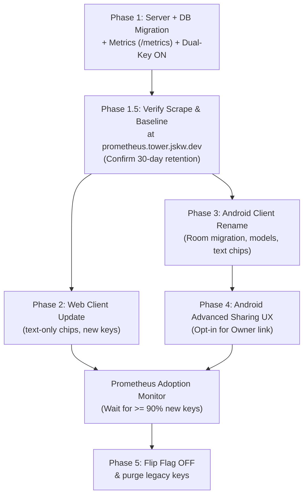

# Roles Refactor Plan — "Owner / Editor / Viewer"

## 1. Problem Statement

Role names are inconsistent across the stack and confusing to users:

| Layer | "Highest" | "Middle" | "Lowest" |
|---|---|---|---|
| **Server enums** (`models.py`, `db.py` CHECK constraint) | `admin` | `read_write` | `read_only` |
| **API JSON** (register request/response, access field) | `admin` / `adminUUID` | `read_write` / `readWriteUUID` | `read_only` / `readOnlyUUID` |
| **Web UI labels** (`app.js` `renderRoleCards`) | "Admin" / 👑 "Full Control" | "Read-Write" / ✍️ "Write & Read" | "Read-Only" / 👁️ "View Only" |
| **Android share chips** (`CounterDetailPane.kt`) | "Full (Admin)" | "Read-Write" | "Read-Only" |
| **Android enum** (`ShareRole`) | `ADMIN` | `READ_WRITE` | `READ_ONLY` |
| **Android model fields** (`Counter.kt`) | `deleteUuid` | `updateUuid` | `viewUuid` |
| **Android UI strings** | "Forget Admin Key" | — | — |

Three different labeling vocabularies are used for the same concept, with no single consistent name a user would recognise.

---

## 2. Target Naming

One word per role, everywhere — API fields, JSON keys, DB columns, UI labels, variable names. **No emoji icons** — clean text-only chips.

| Role | Display Name | API/DB value | JSON key | Description |
|---|---|---|---|---|
| **Owner** | Owner | `owner` | `"owner"` | Full control — delete counter, change settings, share all roles |
| **Editor** | Editor | `editor` | `"editor"` | Can increment & decrement the counter |
| **Viewer** | Viewer | `viewer` | `"viewer"` | Can see the live count (read-only) |

No `UUID` suffix anywhere. The register request body becomes:

```json
{
  "viewer": "xxxxxxxx-xxxx-4xxx-...",
  "editor": "xxxxxxxx-xxxx-4xxx-...",
  "owner":  "xxxxxxxx-xxxx-4xxx-..."
}
```

The register response `roles` dict:

```json
{
  "roles": {
    "viewer": "xxxxxxxx-xxxx-4xxx-...",
    "editor": "xxxxxxxx-xxxx-4xxx-...",
    "owner":  "xxxxxxxx-xxxx-4xxx-..."
  }
}
```

> [!TIP]
> "Owner / Editor / Viewer" follows the same mental model as Google Docs sharing. Users already understand it.

---

## 3. Architecture & Migration Strategy

### 3.1 Option A: Wire-Level & DB Enum Rename

Change wire-format enum values and DB constraints from `admin` → `owner`, `read_write` → `editor`, `read_only` → `viewer`.
- **Pros:** Unified vocabulary across the entire codebase, clean mental model, zero long-term cognitive overhead or translation layers.
- **Cons:** Requires a coordinated database migration and backward-compatibility bridge during beta.

### 3.2 Zero-Downtime Feature Flag — Dual-Key Transition

Since beta testers are actively using the app, the server **must not break old clients** while new clients roll out. The strategy:

**Phase 1 deploys the server with a feature flag** `DUAL_ROLE_KEYS=true` (environment variable or `config.py` constant). While the flag is on:

1. The server **stores** new role values internally (`owner`, `editor`, `viewer`).
2. API **responses** include **both** old and new keys side-by-side:

```json
{
  "roles": {
    "owner": "xxxxxxxx-...",
    "editor": "xxxxxxxx-...",
    "viewer": "xxxxxxxx-...",
    "admin": "xxxxxxxx-...",
    "read_write": "xxxxxxxx-...",
    "read_only": "xxxxxxxx-..."
  },
  "access": "owner",
  "access_legacy": "admin"
}
```

3. The `access` field in `CounterInfoResponse`, WebSocket `connected`, SSE `connected`, broadcast `update`, and `action_ack` payloads **also** includes a legacy `access_legacy` field:

```json
{
  "access": "owner",
  "access_legacy": "admin"
}
```

4. API **requests** accept **both** old and new field names for registration (`owner` or `adminUUID` / `admin_uuid`).
5. Old clients that read `roles["admin"]` or check `access == "read_only"` continue to work seamlessly. New clients read `roles["owner"]` or check `access == "viewer"`.

### 3.3 Prometheus Migration Metrics (`prometheus.tower.jskw.dev`)

To safely verify when it is safe to turn off legacy keys (reaching the 90% client migration threshold), the server must report telemetry on registration formats **before** web and Android clients are updated.

#### Metrics Instrumentation
- Expose standard Prometheus metric endpoint at `/metrics` using `prometheus_client`.
- Define registration counter:
  ```python
  counter_registrations_total = Counter(
      "counter_registrations_total",
      "Total counter registrations partitioned by payload key format",
      ["key_format", "status"]  # key_format: "new", "legacy", "hybrid" | status: "success", "error"
  )
  ```
- **Key Format Classification**:
  - `new`: Request supplied `owner`, `editor`, and/or `viewer`.
  - `legacy`: Request supplied `adminUUID`, `readWriteUUID`, `readOnlyUUID` (or snake_case variants).
  - `hybrid`: Mixed legacy and new parameters (treated as legacy).

#### Prometheus Ingestion (`prometheus.tower.jskw.dev`)
- Update `chart/templates/deployment.yaml` and `chart/templates/service.yaml` with scrape annotations:
  ```yaml
  prometheus.io/scrape: "true"
  prometheus.io/path: "/metrics"
  prometheus.io/port: "8000"
  ```
- Configure/verify the Prometheus scraper at `prometheus.tower.jskw.dev` targets the counter service.

#### Privacy & 30-Day Metrics Retention Policy
> [!IMPORTANT]
> To comply with the project's Privacy Policy (Section 5: *Data Retention and Server Removal*):
> 1. **Zero PII in Metrics**: Metric labels must strictly contain low-cardinality metadata (`key_format`, `status`). Metric labels must **never** contain UUIDs, token hashes, client IPs, user agents, or counter names.
> 2. **30-Day Retention**: Ensure the Prometheus metrics bucket / TSDB at `prometheus.tower.jskw.dev` is configured to retain data for **at most 30 days** (`--storage.tsdb.retention.time=30d` or S3/MinIO bucket lifecycle expiration rule set to 30 days).

---

## 4. Phased Rollout Plan

```
[Phase 1: Server + Metrics + Dual-Key Flag]
                      │
                      ▼
[Phase 1.5: Verify Scrape & Baseline on prometheus.tower.jskw.dev]
                      │
         ┌────────────┴────────────┐
         ▼                         ▼
 [Phase 2: Web Client]   [Phase 3: Android Client]
                                   │
                                   ▼
                         [Phase 4: Android Advanced Sharing]
                                   │
         ┌─────────────────────────┘
         ▼
 [Monitor Prometheus: >90% New Key Ratio]
         │
         ▼
 [Phase 5: Flip Flag OFF & Purge Legacy Keys]
```

### Phase 1 — Server, Database Migration & Prometheus Metrics Instrumentation

> [!IMPORTANT]
> This phase happens first. The server will support both new and legacy formats, and starts reporting metrics to `prometheus.tower.jskw.dev`.

**Files touched:**

| File | Changes |
|---|---|
| [`pyproject.toml`](file:///Users/jsteel/.gemini/antigravity/worktrees/counter/harmonize_user_roles_plan/server/pyproject.toml) | Add `prometheus-client>=0.21.0` dependency. |
| [`models.py`](file:///Users/jsteel/.gemini/antigravity/worktrees/counter/harmonize_user_roles_plan/server/counter/models.py) | Rename `ROLE_PERMISSIONS` keys to `viewer`, `editor`, `owner`. Rename `can_admin` → `can_own`. Update `RegisterRequest` to support new fields (`viewer`, `editor`, `owner`) with backward-compatible aliases for legacy fields. |
| [`config.py`](file:///Users/jsteel/.gemini/antigravity/worktrees/counter/harmonize_user_roles_plan/server/counter/config.py) | Add `DUAL_ROLE_KEYS = os.environ.get("DUAL_ROLE_KEYS", "true").lower() == "true"`. Add `LEGACY_ROLE_MAP`. Add helper functions `maybe_add_legacy_roles()` and `maybe_add_legacy_access()`. |
| [`metrics.py`](file:///Users/jsteel/.gemini/antigravity/worktrees/counter/harmonize_user_roles_plan/server/counter/metrics.py) | Create module with `counter_registrations_total` and helper to classify payload as `new` vs `legacy`. |
| [`main.py`](file:///Users/jsteel/.gemini/antigravity/worktrees/counter/harmonize_user_roles_plan/server/counter/main.py) | Mount `/metrics` endpoint using `prometheus_client.make_asgi_app()`. |
| [`db.py`](file:///Users/jsteel/.gemini/antigravity/worktrees/counter/harmonize_user_roles_plan/server/counter/db.py) | Update `SCHEMA_SQL` CHECK constraint: `role IN ('viewer', 'editor', 'owner')`. Add startup migration script for existing database records. |
| [`service.py`](file:///Users/jsteel/.gemini/antigravity/worktrees/counter/harmonize_user_roles_plan/server/counter/service.py) | Update internal naming (`owner`, `editor`, `viewer`). Wrap `roles_dict` with `maybe_add_legacy_roles()` and response with `maybe_add_legacy_access()`. Increment registration metric by detected format. |
| [`api.py`](file:///Users/jsteel/.gemini/antigravity/worktrees/counter/harmonize_user_roles_plan/server/counter/api.py) | Support dual-key fields in SSE and WebSocket payloads. |
| [`chart/templates/service.yaml`](file:///Users/jsteel/.gemini/antigravity/worktrees/counter/harmonize_user_roles_plan/chart/templates/service.yaml) | Add Prometheus scraping annotations (`prometheus.io/scrape: "true"`, port 8000, path `/metrics`). |

**Database Migration (SQLite):**
```sql
UPDATE counter_tokens SET role = 'viewer' WHERE role = 'read_only';
UPDATE counter_tokens SET role = 'editor' WHERE role = 'read_write';
UPDATE counter_tokens SET role = 'owner' WHERE role = 'admin';

UPDATE counter_events SET role = 'viewer' WHERE role = 'read_only';
UPDATE counter_events SET role = 'editor' WHERE role = 'read_write';
UPDATE counter_events SET role = 'owner' WHERE role = 'admin';
```

---

### Phase 1.5 — Verification & Metrics Baseline at `prometheus.tower.jskw.dev`

Before deploying new client builds:
1. Deploy updated server image with `DUAL_ROLE_KEYS=true`.
2. Confirm `GET /metrics` returns `counter_registrations_total`.
3. Check `prometheus.tower.jskw.dev` target discovery to confirm the pod/service is being scraped successfully.
4. Verify baseline: Existing active clients register with `key_format="legacy"` (100% legacy ratio).
5. Verify metrics bucket / TSDB retention policy on `prometheus.tower.jskw.dev` is configured for **30 days**.

---

### Phase 2 — Web Client

**Files touched:**

| File | Changes |
|---|---|
| [`app.js`](file:///Users/jsteel/.gemini/antigravity/worktrees/counter/harmonize_user_roles_plan/web/app.js) | Full rename across ~30 references. Remove all emojis, use clean text chips. Update link anchors to `#owner#`, `#editor#`, `#viewer#` with backward-compatible parsing for existing `#admin#`, `#write#`, `#read#` links. |

**Key changes:**
1. `currentRole` initial value: `"admin"` → `"owner"`.
2. `applyRolePermissions()`: Role display text `"Owner"`, `"Editor"`, `"Viewer"`.
3. `renderRoleCards()`: Remove all emoji icons (👑 ✍️ 👁️). Render clean text-only badge chips.
4. `buildShareHash()`: `#owner#`, `#editor#`, `#viewer#`. Lookup tokens via `tokens.owner`, `tokens.editor`, `tokens.viewer`.
5. Registration payload: Send `owner`, `editor`, `viewer` (no UUID suffix).

---

### Phase 3 — Android Client

**Files touched:**

| File | Changes |
|---|---|
| [`CounterLinkParser.kt`](file:///Users/jsteel/.gemini/antigravity/worktrees/counter/harmonize_user_roles_plan/android/app/src/main/java/dev/jskw/counter/util/CounterLinkParser.kt) | Rename `ShareRole.ADMIN` → `ShareRole.OWNER`, `ShareRole.READ_WRITE` → `ShareRole.EDITOR`, `ShareRole.READ_ONLY` → `ShareRole.VIEWER`. Support both new and legacy anchor keywords. |
| [`Counter.kt`](file:///Users/jsteel/.gemini/antigravity/worktrees/counter/harmonize_user_roles_plan/android/app/src/main/java/dev/jskw/counter/data/model/Counter.kt) | Rename Room columns: `deleteUuid` → `owner`, `updateUuid` → `editor`, `viewUuid` → `viewer`. Rename properties: `canForgetAdminKey` → `canForgetOwnerKey`, `effectiveAdminToken` → `effectiveOwnerToken`. |
| [`CounterDetailPane.kt`](file:///Users/jsteel/.gemini/antigravity/worktrees/counter/harmonize_user_roles_plan/android/app/src/main/java/dev/jskw/counter/ui/components/CounterDetailPane.kt) | Text-only chips: `"Owner"`, `"Editor"`, `"Viewer"`. Rename dialogs and buttons: "Forget Owner Key". |
| [`RemoteModels.kt`](file:///Users/jsteel/.gemini/antigravity/worktrees/counter/harmonize_user_roles_plan/android/app/src/main/java/dev/jskw/counter/data/remote/RemoteModels.kt) | Rename `RegisterRequest` fields: `owner`, `editor`, `viewer`. |
| [`CounterApiService.kt`](file:///Users/jsteel/.gemini/antigravity/worktrees/counter/harmonize_user_roles_plan/android/app/src/main/java/dev/jskw/counter/data/remote/CounterApiService.kt) | Rename `publishCounter()` parameters: `owner`, `editor`, `viewer`. |
| [`KtorCounterApiService.kt`](file:///Users/jsteel/.gemini/antigravity/worktrees/counter/harmonize_user_roles_plan/android/app/src/main/java/dev/jskw/counter/data/remote/KtorCounterApiService.kt) | Matching parameter renames. |
| [`CounterRepositoryImpl.kt`](file:///Users/jsteel/.gemini/antigravity/worktrees/counter/harmonize_user_roles_plan/android/app/src/main/java/dev/jskw/counter/data/repository/CounterRepositoryImpl.kt) | Rename `forgetAdminKey()` → `forgetOwnerKey()`. Update role dictionary resolution: `roles["owner"]`, `roles["editor"]`, `roles["viewer"]`. |
| [`CounterRepository.kt`](file:///Users/jsteel/.gemini/antigravity/worktrees/counter/harmonize_user_roles_plan/android/app/src/main/java/dev/jskw/counter/data/repository/CounterRepository.kt) | Rename interface method `forgetOwnerKey()`. |
| [`CounterViewModel.kt`](file:///Users/jsteel/.gemini/antigravity/worktrees/counter/harmonize_user_roles_plan/android/app/src/main/java/dev/jskw/counter/ui/CounterViewModel.kt) | Rename `forgetAdminKey()` → `forgetOwnerKey()`. Notification: "Owner key forgotten". |

**Room Database Migration:**
```kotlin
val MIGRATION_X_Y = object : Migration(X, Y) {
    override fun migrate(db: SupportSQLiteDatabase) {
        db.execSQL("ALTER TABLE counters RENAME COLUMN deleteUuid TO owner")
        db.execSQL("ALTER TABLE counters RENAME COLUMN updateUuid TO editor")
        db.execSQL("ALTER TABLE counters RENAME COLUMN viewUuid TO viewer")
    }
}
```

---

### Phase 4 — Android "Advanced Sharing" Opt-In

**New UX Behavior:**
1. **Default State**:
   - Share section only displays **Editor** and **Viewer** chips.
   - **Owner** chip is hidden to prevent accidental full-control sharing.
   - **"Forget Owner Key"** button is hidden by default.
2. **Opt-in Toggle**:
   - Add an **"Advanced sharing"** toggle in the share section header or dropdown menu.
   - When enabled, the **Owner** chip and the **"Forget Owner Key"** action become visible.
   - Store setting in `SharedPreferences` (defaults to `false`).

---

### Phase 5 — Metric-Driven Deprecation & Cleanup

Once Prometheus metrics at `prometheus.tower.jskw.dev` demonstrate $\ge 90\%$ of registration traffic uses `key_format="new"`:
```promql
sum(rate(counter_registrations_total{key_format="new"}[7d]))
/
sum(rate(counter_registrations_total[7d])) >= 0.90
```
1. Set `DUAL_ROLE_KEYS=false` in environment/config.
2. Remove legacy mapping functions (`maybe_add_legacy_roles`, `maybe_add_legacy_access`).
3. Remove legacy alias fields from `RegisterRequest`.
4. Drop `access_legacy` from response models.
5. Clean up dual-key test cases.

---

## 5. Backward Compatibility & Privacy Checklist

| Area | Requirement | Solution / Safeguard |
|---|---|---|
| **Zero Downtime API** | Old apps must not break during rollout | Feature flag `DUAL_ROLE_KEYS=true` returns both old and new keys simultaneously. |
| **Old Links** | Links with `#admin#`, `#read#`, `#write#` must still work | Parsers in both web and Android permanently support old and new keywords. |
| **Existing Database** | Stored rows have old role strings | SQLite migration updates existing records to `owner`, `editor`, `viewer`. |
| **Client Migration Tracking** | Need objective adoption data before turning off legacy keys | Prometheus metric `counter_registrations_total{key_format="new|legacy"}` at `prometheus.tower.jskw.dev`. |
| **Privacy Compliance** | Section 5 retention policy (< 30 days) | Metric labels contain **zero PII**; Prometheus TSDB/bucket retention is set to **30 days**. |

---

## 6. Work Breakdown & Ordering



| Phase | Description | Est. Effort | Risk |
|---|---|---|---|
| **1 — Server & Metrics** | Server migration, dual-key feature flag, `prometheus-client` `/metrics` route, Helm scrape annotations | ~3 hours | Low (dual-key is non-breaking) |
| **1.5 — Metrics Verification** | Verify target scraping at `prometheus.tower.jskw.dev`, confirm 30-day retention, establish baseline | ~30 min | Low |
| **2 — Web Client** | Update `app.js` with new names, text-only chips, backward-compatible parser | ~1.5 hours | Low |
| **3 — Android Rename** | Room migration, models, repository, text-only chips | ~2 hours | Medium (Room DB migration) |
| **4 — Android Advanced Sharing** | Opt-in toggle to reveal Owner chip and Forget Owner Key button | ~1 hour | Low (UI-only) |
| **5 — Flag Deprecation** | Flip flag to false once metrics confirm $\ge 90\%$ adoption, remove legacy aliases | ~30 min | Low |

---

## 7. Future Considerations

- **Owner-Only Capabilities**: Future capabilities like retention policy configuration, reset actions, and delta limits will naturally enforce `can_own` permission.
- **Role Extensibility**: The Owner / Editor / Viewer structure cleanly supports future roles (e.g. "Commenter" or "Auditor") without ambiguous abbreviations.
